<div align="center">

<picture>
  <source media="(prefers-color-scheme: dark)" srcset="https://raw.githubusercontent.com/fariztiger/fariztiger/main/assets/banner-dark.svg">
  <source media="(prefers-color-scheme: light)" srcset="https://raw.githubusercontent.com/fariztiger/fariztiger/main/assets/banner-light.svg">
  
</picture>

<a href="#focus"></a>
<a href="#background"></a>
<a href="#hire"></a>

**Trading tools, learning platforms and research — built small, tested honestly, documented properly.**

[Focus](#focus) · [Stack](#stack) · [Work](#work) · [Numbers](#numbers) · [Learning](#learning) · [Hire me](#hire) · [Contact](#connect)

</div>


<a id="about"></a>

## ⚡ About

I'm **Faiz Suhaimi** — an independent developer in Malaysia working where **financial markets, blockchain and software quality** meet.

I came to code through healthcare, where a bad record has consequences. That's still how I work: reproducible steps, stated limits, and no claim I can't back with a link.

```ts
const focus = {
  trading:  "automation, not promises",   // MQL4/MQL5, XAUUSD research, dashboards
  web3:     "research + education",       // XRPL, wallet security, smart contracts
  software: "quality over churn",         // Python tooling, QA, reproducible bugs
  mindset:  "build → measure → improve",
} as const;
```

<a id="focus"></a>

## 🎯 What I Do

- 📈 **Trading systems** — EA and indicator repair, MQL4/MQL5 customisation, signal logic, execution monitoring, dashboards.
- 🐍 **Python automation** — data cleanup, backtest research, reporting, and repeatable analysis pipelines.
- 🌐 **Web & education** — dependency-light sites and interactive learning platforms. Vanilla JS and hand-written SVG first; Next.js when a project earns it.
- ⛓️ **Web3 research** — XRPL explainers, protocol comparisons, and specs turned into material a beginner can follow.
- 🧪 **QA & documentation** — manual test passes, reproducible bug reports, docs that state the limitations out loud.


<a id="stack"></a>

## 🛠️ Stack

<picture>
  <source media="(prefers-color-scheme: dark)" srcset="https://raw.githubusercontent.com/fariztiger/fariztiger/main/assets/stack-dark.svg">
  <source media="(prefers-color-scheme: light)" srcset="https://raw.githubusercontent.com/fariztiger/fariztiger/main/assets/stack-light.svg">
  
</picture>

Solidity, Ethereum and Foundry work is **coursework and labs**, not production auditing. I'd rather label that than pad the list.


<a id="work"></a>

## 📂 Featured Work

**01 · XRPL Interactive Learning Lab** · *Education · Web3*
A full curriculum for the XRP Ledger: consensus lab, asset explorer, an XLS-66 lending walkthrough, a quiz, and an explainer video rendered with Remotion. Every claim links to a primary source; no simulation touches a wallet.
`HTML` `CSS` `Vanilla JS` `Remotion` — **[live ↗](https://fariztiger.github.io/xrpl-education/)** · [source](https://github.com/fariztiger/xrpl-education)

**02 · TIGERFX Academy** · *Education · Product*
Bilingual (BM/EN) trading education on a bespoke canvas chart engine. Replay renders *no future candles at all*, so hindsight leaks are structurally impossible. Scenario practice arena, risk-first toolkit.
`Next.js 14` `TypeScript` `Tailwind` `Canvas` — **[live ↗](https://learning-psi-coral.vercel.app)** · [source](https://github.com/fariztiger/learning)

**03 · Sentinel** · *Security · Tooling*
Zero-dependency workspace for reviewing HTML/JS and response headers. Says plainly that it runs lexical heuristics — no telemetry, no storage, no invented severity scores.
`Vanilla JS` `Static HTML` — [source](https://github.com/fariztiger/sentinel)

**04 · TIGER Web3 Security Lab** · *Security · Research*
Public lab for wallet-security learning and testing documentation, including structured reviews of wallet flows in authorised test environments.
`Research` `Wallet security` — [source](https://github.com/fariztiger/TIGER-Web3-Security-Lab)

**05 · TIGER GOLD LAB** · *Trading · Research*
XAUUSD research: MetaTrader indicator experiments, execution monitoring, dashboard tooling. Prototypes, not a signal service.
`MQL4/MQL5` `XAUUSD` — [project notes ↗](https://fariztiger.github.io/portfolio/#work)

**06 · Personal Portfolio** · *Web · Craft*
One page, inline SVG icons, no icon CDN, no webfonts, no build step — an exercise in shipping fast with nothing to break.
`HTML` `CSS` `GitHub Pages` — **[live ↗](https://fariztiger.github.io/portfolio/)** · [source](https://github.com/fariztiger/portfolio)

<details>
<summary><b>Also in the workshop</b> (study forks, not my work)</summary>

<br>

Quant and agent frameworks I read and run rather than ship: `openalgo`, `exchange-core`, `TradeMaster`, `zvt`, `Finance`, `stocksight`, `StockSharp`, `tradingagents-codex-native`, `smart-money-concepts`, plus agent-skill collections for OpenZeppelin, CertiK and blockchain workflows.

</details>


<a id="numbers"></a>

## 📊 Numbers

<div align="center">

<picture>
  <source media="(prefers-color-scheme: dark)" srcset="https://github-readme-stats.vercel.app/api?username=fariztiger&show_icons=true&hide_rank=true&hide=contribs&bg_color=00000000&border_color=4EE1C040&title_color=4EE1C0&icon_color=F5C451&text_color=C6D4E6">
  
</picture>
<picture>
  <source media="(prefers-color-scheme: dark)" srcset="https://streak-stats.demolab.com?user=fariztiger&background=00000000&border=4EE1C040&ring=4EE1C0&fire=F5C451&currStreakLabel=4EE1C0&sideLabels=C6D4E6&dates=8FA6C0&sideNums=C6D4E6&currStreakNum=F5C451">
  
</picture>

<picture>
  <source media="(prefers-color-scheme: dark)" srcset="https://github-readme-activity-graph.vercel.app/graph?username=fariztiger&bg_color=00000000&color=C6D4E6&line=4EE1C0&point=F5C451&area=true&area_color=4EE1C0&hide_border=true">
  
</picture>

</div>

381 public repositories, most of them study forks. The language split is HTML-heavy because my shipped work is interactive web education. Judge me on the six projects above, not on a commit count.


<a id="learning"></a>

## 🏆 Highlights

- Two **live educational platforms** built and hosted end to end — [XRPL Learning Lab](https://fariztiger.github.io/xrpl-education/) and [TIGERFX Academy](https://learning-psi-coral.vercel.app).
- **Six Cyfrin Updraft courses** across DeFi, Solidity tooling, smart-contract security, EVM assembly and wallet security.
- Building since **2016** across markets, automation and blockchain.
- An unusual route in — nursing, then neuro-technical healthcare, then independent software.

### 🎖️ Verified Learning

| Course | Track | Covered |
| :-- | :-- | :-- |
| **Uniswap v4** | DeFi | Hooks, pools, liquidity mechanics |
| **Foundry Fundamentals** | Development | Solidity toolchain, testing, fuzzing |
| **Smart Contract Security** | Security | Vulnerability classes, review discipline |
| **Assembly & Formal Verification** | Security | EVM assembly, invariants, verification |
| **Web3 Wallet Security Basics** | Wallet | Key management, approvals, attack paths |
| **Advanced Web3 Wallet Security** | Wallet | Wallet threat models and controls |

[**Achievements profile ↗**](https://profiles.cyfrin.io/u/faizsuhaimi/achievements) — course completions, not a professional audit certification.


<a id="background"></a>

## 🎓 Background

| | |
| :-- | :-- |
| **2013** | Bachelor (Hons) Nursing Practice Development — Northumbria University |
| **2008** | Diploma in Medical Assisting — Kolej Pembantu Perubatan Seremban |
| **Career** | Healthcare with Malaysia's Ministry of Health, including specialist neuro-technical work |
| **Since 2016** | Self-directed development: markets, MetaTrader, automation, blockchain |
| **Languages** | Bahasa Melayu · English |


<a id="now"></a>

## 📈 Right Now

- 🔭 **Building** — XRPL Learning Lab content, MT5 execution-monitoring research
- 🌱 **Learning** — smart-contract security (Foundry tests, invariants), XLS-66 lending mechanics
- 🧪 **Practising** — manual QA on wallet and checkout flows in authorised test environments
- 💬 **Ask me about** — MQL4/MQL5 troubleshooting, trading dashboards, XRPL basics, bilingual course design


<a id="hire"></a>

## 🤝 Work With Me

Small, clearly scoped freelance work — one deliverable, stated limits, no retainer traps.

| Area | What you get | Typical scope |
| :-- | :-- | :-- |
| 📈 **MT4 / MT5** | EA and indicator fixes, MQL4/MQL5 customisation, dashboards | 1–2 weeks |
| 🐍 **Python automation** | Scripts, data cleanup, research and reporting pipelines | 3–10 days |
| 🌐 **Web** | Responsive sites, landing pages, interactive education | 1–3 weeks |
| ⛓️ **Web3 research** | Explainers, protocol comparisons, documentation | 3–7 days |
| 🧪 **QA / usability** | Test passes, reproducible bug reports, interface feedback | 2–5 days |

Send the task, the constraints and your deadline. I confirm scope and feasibility **before** quoting — and I'll tell you if it isn't a fit.

<a href="mailto:tigerhyip@gmail.com?subject=Project%20enquiry%20for%20Faiz%20Suhaimi"></a>


<a id="connect"></a>

## 📬 Connect

<div align="center">

<a href="https://fariztiger.github.io/portfolio/"></a>
<a href="https://www.linkedin.com/in/faizsuhaimi36/"></a>
<a href="mailto:tigerhyip@gmail.com"></a>
<a href="https://profiles.cyfrin.io/u/faizsuhaimi/achievements"></a>

<br><br>

**Make it work. Make it measurable. Make it better.**

<sub>Education and research only — none of this is financial advice.</sub>

</div>
