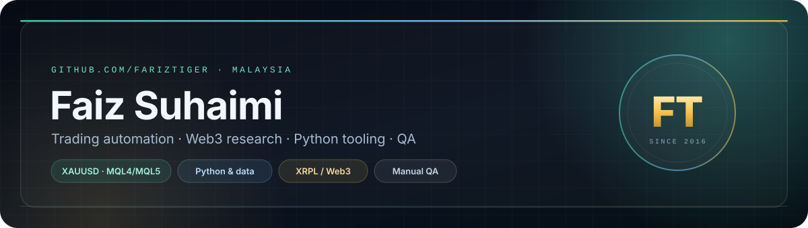

<div align="center">

<picture>
  <source media="(prefers-color-scheme: dark)" srcset="https://raw.githubusercontent.com/fariztiger/fariztiger/main/assets/banner-dark.svg">
  <source media="(prefers-color-scheme: light)" srcset="https://raw.githubusercontent.com/fariztiger/fariztiger/main/assets/banner-light.svg">
  
</picture>

<a href="#focus"></a>
<a href="#background"></a>
<a href="#hire"></a>
<a href="#learning"></a>

**I build small, testable systems — trading tools, learning platforms, and research — then document what actually works.**

[**About**](#about) · [**Focus**](#focus) · [**Stack**](#stack) · [**Work**](#work) · [**Learning**](#learning) · [**Hire me**](#hire) · [**Contact**](#connect)

<sub>GitHub since 2016 · 381 public repositories · EN / BM</sub>

</div>


<a id="about"></a>

## ⚡ The short version

I'm **Faiz Suhaimi** (Fariz Tiger online) — an independent developer in Malaysia working at the intersection of **financial markets, blockchain, and software quality**.

My background started in healthcare, where careful observation and precise documentation are non-negotiable. I bring that same discipline to code: reproducible steps, honest limitations, and no claims I can't verify.

```ts
const focus = {
  trading:  "automation, not promises",   // MQL4/MQL5, XAUUSD research, dashboards
  web3:     "research + education",       // XRPL, wallet security, smart contracts
  software: "quality over churn",         // Python tooling, QA, reproducible bugs
  mindset:  "build → measure → improve",
} as const;
```

> **Make it work. Make it measurable. Make it better.**


<a id="focus"></a>

## 🎯 What I Do

| | |
| :-- | :-- |
| 📈 **Trading systems**<br><sub>MetaTrader tooling</sub> | EA and indicator repair, MQL4/MQL5 customisation, signal logic, execution monitoring and dashboards for XAUUSD research workflows. |
| 🐍 **Automation & data**<br><sub>Python</sub> | Scripts for data cleanup, backtest research, reporting and repeatable analysis — plus the ugly CSV/Excel work nobody enjoys. |
| 🌐 **Web & education**<br><sub>Frontend</sub> | Responsive, dependency-light sites and interactive learning platforms. Vanilla JS and hand-written SVG first; Next.js when a project earns it. |
| ⛓️ **Web3 research**<br><sub>Blockchain</sub> | XRPL explainers, protocol comparisons, XLS/EVM reading, and turning specs into material a beginner can actually follow. |
| 🧪 **QA & documentation**<br><sub>Quality</sub> | Manual test passes, usability review, reproducible bug reports, and docs that state the limitations out loud. |
| 🧰 **Technical writing**<br><sub>Content</sub> | Research-backed articles, course-style lessons and bilingual (EN/BM) educational copy. |


<a id="stack"></a>

## 🛠️ Stack

**Languages & core**


**Web & tooling**


**Blockchain & markets**


<sub>Honest labels: **learning** means coursework and lab work, not production claim. Badges are the only external images on this profile that aren't self-hosted — the text above stays readable if a service is down.</sub>


<a id="work"></a>

## 📂 Featured Work

**01 · XRPL Interactive Learning Lab** — *Education · Web3*
An interactive curriculum for the XRP Ledger: consensus lab, asset explorer, an XLS-66 lending walkthrough, a quiz, and a Remotion-powered explainer video. Every claim links to primary sources; simulations never touch a wallet.
`HTML` · `CSS` · `Vanilla JS` · `Remotion`
**[Live site ↗](https://fariztiger.github.io/xrpl-education/)** · [Source](https://github.com/fariztiger/xrpl-education)

**02 · TIGERFX Academy** — *Education · Product*
A bilingual (BM/EN) trading-education platform built on a bespoke canvas chart engine — replay renders no future candles at all, so hindsight leaks are structurally impossible. Scenario-based practice arena, risk-first toolkit, Next.js 14 + TypeScript + Tailwind.
`Next.js 14` · `TypeScript` · `Tailwind` · `Canvas`
**[Live site ↗](https://learning-psi-coral.vercel.app)** · [Source](https://github.com/fariztiger/learning)

**03 · Sentinel — Security Review Workspace** — *Security · Tooling*
A zero-dependency static workspace for reviewing HTML/JS sources and response headers. Explicit about being lexical heuristics, not a scanner — no telemetry, no storage, no pretend severity scores.
`Vanilla JS` · `Static HTML` · `Netlify`
[Source](https://github.com/fariztiger/sentinel)

**04 · TIGER Web3 Security Lab** — *Security · Research*
A public lab for wallet-security learning and testing-focused documentation, including structured reviews of wallet flows in authorised test environments.
`Research` · `Wallet security` · `Docs`
[Source](https://github.com/fariztiger/TIGER-Web3-Security-Lab)

**05 · TIGER GOLD LAB** — *Trading · Research*
Independent XAUUSD work: MetaTrader indicator experiments, execution monitoring, and dashboard tooling. Research prototypes — not a signal service, not a promise of profit.
`MQL4/MQL5` · `XAUUSD` · `Automation`
[Project notes ↗](https://fariztiger.github.io/portfolio/#work)

**06 · Personal Portfolio** — *Web · Craft*
A one-page site with inline SVG icons, no icon CDN, no external fonts, no build step — a deliberate exercise in shipping something fast and dependency-free.
`HTML` · `CSS` · `GitHub Pages`
**[Live site ↗](https://fariztiger.github.io/portfolio/)** · [Source](https://github.com/fariztiger/portfolio)

<details>
<summary><b>Also in the workshop</b> — study forks and reading material</summary>

<br>

Quant and agent frameworks I read, run, and learn from rather than ship: `openalgo`, `exchange-core`, `TradeMaster`, `zvt`, `Finance`, `stocksight`, `StockSharp`, `tradingagents-codex-native`, `smart-money-concepts`, plus agent-skill collections for OpenZeppelin, CertiK and blockchain workflows.

Forked repos are kept for study. Anything I built myself is listed above with a working link.
</details>


## 📊 GitHub Snapshot

<div align="center">

<picture>
  <source media="(prefers-color-scheme: dark)" srcset="https://github-readme-stats.vercel.app/api?username=fariztiger&show_icons=true&hide_rank=true&hide=contribs&bg_color=00000000&border_color=4EE1C040&title_color=4EE1C0&icon_color=F5C451&text_color=C6D4E6&include_all_commits=false">
  
</picture>
<picture>
  <source media="(prefers-color-scheme: dark)" srcset="https://streak-stats.demolab.com?user=fariztiger&hide_border=false&background=00000000&border=4EE1C040&stroke=4EE1C040&ring=4EE1C0&fire=F5C451&currStreakLabel=4EE1C0&sideLabels=C6D4E6&dates=8FA6C0&sideNums=C6D4E6&currStreakNum=F5C451">
  
</picture>

<picture>
  <source media="(prefers-color-scheme: dark)" srcset="https://github-readme-stats.vercel.app/api/top-langs/?username=fariztiger&layout=compact&langs_count=8&hide_title=false&bg_color=00000000&border_color=4EE1C040&title_color=4EE1C0&text_color=C6D4E6">
  
</picture>

<picture>
  <source media="(prefers-color-scheme: dark)" srcset="https://github-readme-activity-graph.vercel.app/graph?username=fariztiger&bg_color=00000000&color=C6D4E6&line=4EE1C0&point=F5C451&area=true&area_color=4EE1C0&hide_border=true&custom_title=Contribution%20activity">
  
</picture>

</div>

<sub>**Reading the numbers honestly:** 381 public repositories sounds like a lot — most are study forks and learning copies, and the language split is dominated by HTML because my shipped work is interactive web education. I'd rather be judged on the six projects above than on a commit count. Cards are third-party services; if one doesn't load, the rest of this page still works.</sub>


<a id="learning"></a>

## 🏆 Highlights

- **Shipped and hosted two live educational platforms** — [XRPL Learning Lab](https://fariztiger.github.io/xrpl-education/) and [TIGERFX Academy](https://learning-psi-coral.vercel.app) — both public, both with readable source.
- **Six Cyfrin Updraft courses completed** across DeFi architecture, Solidity tooling, smart-contract security, EVM assembly and wallet security.
- **Since 2016** — 381 public repositories and 1,000+ commits, though most of those repositories are study forks I keep for reference rather than trophies.
- **An unusual path in** — nursing, then neuro-technical healthcare work, then independent software. Clinical documentation discipline is why my bug reports are short and reproducible.

### 🎖️ Verified Learning

Six completed **[Cyfrin Updraft](https://profiles.cyfrin.io/u/faizsuhaimi/achievements)** courses — verifiable on the public profile, no screenshots required.

| Course | Track | What it covered |
| :-- | :-- | :-- |
| **Uniswap v4** | DeFi | Hooks, pool architecture, liquidity mechanics |
| **Foundry Fundamentals** | Development | Solidity toolchain, testing and fuzzing |
| **Smart Contract Security** | Security | Common vulnerability classes and review discipline |
| **Assembly & Formal Verification** | Security | EVM assembly, invariants, verification approaches |
| **Web3 Wallet Security Basics** | Wallet | Key management, approvals, common attack paths |
| **Advanced Web3 Wallet Security** | Wallet | Deeper wallet threat models and controls |

[**View the achievements profile ↗**](https://profiles.cyfrin.io/u/faizsuhaimi/achievements)

<sub>These are course-completion records. They are **not** a professional audit certification, and I don't market them as one.</sub>


<a id="background"></a>

## 🎓 Background

| | |
| :-- | :-- |
| **2013** | Bachelor (Hons) Nursing Practice Development — Northumbria University |
| **2008** | Diploma in Medical Assisting — Kolej Pembantu Perubatan Seremban |
| **Career** | Healthcare with Malaysia's Ministry of Health, including specialist neuro-technical work |
| **Since 2016** | Self-directed development: markets, MetaTrader, automation, blockchain |
| **Languages** | Bahasa Melayu (native) · English (professional) |

Clinical work taught me the thing most engineering talk skips: **write it so someone else can reproduce it.** That habit became the through-line of everything I build.


<a id="now"></a>

## 📈 Right Now

- 🔭 **Building** — XRPL Learning Lab content, plus MT5 execution-monitoring research
- 🌱 **Learning** — smart-contract security (Foundry tests, invariants) and XLS-66 lending mechanics
- 🧪 **Practising** — manual QA on wallet and checkout flows inside authorised test environments
- 🧠 **Reading** — market-microstructure papers, XRPL amendment history, EVM internals
- 💬 **Ask me about** — MQL4/MQL5 troubleshooting, trading dashboards, XRPL basics, bilingual education design
- ⚡ **Rule I work by** — if I can't show you the failing case, I haven't finished testing


<a id="hire"></a>

## 🤝 Work With Me

Small, clearly scoped freelance engagements — a fixed deliverable, a stated limitation, no retainer traps.

| Area | What you get | Typical scope |
| :-- | :-- | :-- |
| 📈 **MT4 / MT5** | EA and indicator fixes, MQL4/MQL5 customisation, dashboards | 1–2 weeks |
| 🐍 **Python automation** | Scripts, data cleanup, research and reporting pipelines | 3–10 days |
| 🌐 **Web** | Responsive sites, landing pages, interactive educational interfaces | 1–3 weeks |
| ⛓️ **Web3 research** | Explainers, protocol comparisons, documentation that survives review | 3–7 days |
| 🧪 **QA / usability** | Test passes, reproducible bug reports, interface feedback | 2–5 days |
| ✍️ **Technical content** | Research-backed articles and bilingual course material | Per piece |

**How I start:** send the task, the constraints, and your deadline. I'll confirm scope and feasibility **before** quoting — and tell you if it's not a fit.

<a href="mailto:tigerhyip@gmail.com?subject=Project%20enquiry%20for%20Faiz%20Suhaimi"></a>


<a id="connect"></a>

## 📬 Connect

<div align="center">

<a href="https://fariztiger.github.io/portfolio/"></a>
<a href="https://www.linkedin.com/in/faizsuhaimi36/"></a>
<a href="mailto:tigerhyip@gmail.com"></a>
<a href="https://profiles.cyfrin.io/u/faizsuhaimi/achievements"></a>
<a href="https://github.com/fariztiger?tab=repositories"></a>

<br><br>

### 🐯 Make it work. Make it measurable. Make it better.

<sub>Education and research only — nothing here is financial advice. · Built with hand-written SVG, native Markdown, and a preference for pages that load fast.</sub>

</div>
